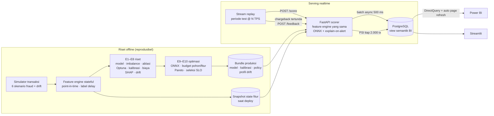

# 🛡️ Real-time Fraud Detection


**Sistem deteksi fraud transaksi kartu secara end-to-end**, dari riset model sampai dashboard yang bergerak live.
Setiap transaksi dinilai dalam hitungan milidetik dan diberi keputusan **APPROVE / REVIEW / BLOCK** beserta alasan
dalam Bahasa Indonesia. Hasilnya dipantau di **Power BI** yang ter-refresh otomatis tiap 3 detik.


---

## Ringkasan

| | |
|---|---|
| **Masalah** | Fraud < 1% dari transaksi, labelnya (chargeback) datang terlambat, polanya terus berubah, dan keputusan harus keluar dalam milidetik saat otorisasi kartu |
| **Pendekatan** | Feature engine *point-in-time* yang sama untuk training & serving, split berbasis waktu dengan *label delay*, threshold berbasis biaya Rupiah, dan pemilihan model berdasarkan Pareto akurasi–latensi di bawah SLO |
| **Hasil** | AUPRC **0,844** (aturan manual 0,474) · recall **79,8%** pada precision **83,5%** · **Rp 1,66 miliar** net savings di periode test · p99 end-to-end **4,2 ms** |

### Hasil utama (test out-of-time 23 hari, 171.612 transaksi)

| Aspek | Hasil |
|---|---|
| Model produksi | LightGBM (29 fitur, 1.066 pohon, di-tuning Optuna) → ONNX Runtime single-thread |
| Kualitas ranking | AUPRC **0,844** · ROC-AUC 0,977 · Precision@50/hari 0,86 |
| Keputusan REVIEW | recall **79,8%** · precision **83,5%** · alert hanya 0,77% dari transaksi |
| Keputusan BLOCK otomatis | precision **93,3%** (threshold dipilih agar precision ≥ 90% di validasi) |
| Nilai bisnis | 68,5% nilai fraud tercegah · **net savings Rp 1,66 miliar** setelah biaya analis & friksi nasabah |
| Latensi | model p99 **0,137 ms** · fitur + model + reason code p99 **4,2 ms** (SLO 15 ms ✓) |
| Throughput | ±960 req/s per worker HTTP; server-side p99 tetap 0,6–4,6 ms di semua level beban |
| Konsistensi fitur | selisih fitur online vs offline: **0** (diuji otomatis) |

### Temuan riset yang paling menarik

1. **Runtime lebih menentukan latensi daripada arsitektur model.** Pada akurasi sebanding, RandomForest (sklearn)
   p99 19 ms vs LightGBM di ONNX Runtime 0,137 ms, alias **141× lebih cepat**.
2. **Explainability adalah biaya latensi terbesar.** Menghitung SHAP untuk setiap transaksi butuh ±6,5 ms, jauh di atas
   inferensinya (0,1 ms). Strategi *explain-on-alert* menurunkan p50 end-to-end dari 6,6 ms ke 0,14 ms.
3. **Concept drift tidak terdeteksi oleh PSI.** Pola scam baru (`social_engineering`) menurunkan recall mingguan dari
   0,79 ke 0,59, padahal PSI semua fitur tetap < 0,005. Monitoring produksi butuh dua lapis: PSI **dan** performa berlabel.
4. **Kalibrasi isotonic bisa merusak ranking.** Fungsi tangganya membuat skor kembar sehingga AUPRC turun ±0,02.
   Diperbaiki dengan *tie-break* yang menjaga pemetaan tetap monoton ketat.
5. **Event out-of-order benar-benar terjadi.** Load test konkuren membuat feature engine versi awal crash. Sekarang
   event terlambat disisipkan di posisi waktunya, dan perilaku ini dikunci oleh unit test.

📄 Laporan riset lengkap (E1–E11, di-generate otomatis dari hasil run): [`reports/RESEARCH_REPORT.md`](reports/RESEARCH_REPORT.md)

---

## Dashboard Power BI

| Business Impact | Model Health | Research & Trade-offs |
|---|---|---|
|  |  |  |

- **4 halaman, 73 visual, 40 measure DAX.** Mode DirectQuery ke PostgreSQL dengan *auto page refresh* 3–5 detik.
- **Dashboard as code.** File [`FraudOps.pbip`](dashboard/powerbi/) (semantic model TMDL + report PBIR) di-generate
  oleh [`build_pbip.py`](dashboard/powerbi/build_pbip.py). Setiap perubahan bisa di-review lewat diff Git.
- Warna status (hijau/kuning/merah) hanya dipakai bila nilainya punya arti dan selalu disertai label. Nominal tampil
  dalam format Rupiah. Detail desain dan catatan teknisnya ada di [`dashboard/powerbi/README.md`](dashboard/powerbi/README.md).
- Tanpa Power BI? Dashboard Streamlit membaca view yang sama: `streamlit run dashboard/streamlit/app.py`.

---

## Arsitektur



### Keputusan desain

| Keputusan | Alasan |
|---|---|
| **Satu feature engine untuk offline & online** | Training–serving skew tidak mungkin terjadi; parity diuji di `tests/test_serving.py` |
| **Split berbasis waktu + gap 7 hari** | Chargeback matang ±7 hari. Random split membocorkan masa depan dan memberi skor yang terlalu optimis |
| **AUPRC, Precision@K/hari, dan nilai Rupiah** | Akurasi tidak bermakna pada fraud rate < 1%. Yang penting bagi bisnis adalah kapasitas analis dan kerugian |
| **Kalibrasi isotonic + threshold berbasis biaya** | Threshold 0,5 tidak punya arti. REVIEW = net savings maksimum, BLOCK = precision ≥ 90% |
| **Scoring sinkron, penulisan DB asinkron** | Otorisasi kartu butuh jawaban dalam milidetik, jadi penulisan ke database dikeluarkan dari jalur latensi |
| **ONNX single-thread + explain-on-alert** | Hasil E9/E10: runtime dan strategi SHAP lebih menentukan latensi daripada pilihan model |
| **DirectQuery + auto page refresh** | Fitur *streaming dataset* Power BI sedang dipensiunkan Microsoft; pola ini tetap didukung |

---

## Alur riset

Seleksi model hanya memakai data validasi; data test (out-of-time) disentuh sekali untuk pelaporan.

| # | Pertanyaan | Jawaban singkat |
|---|---|---|
| E1 | Model apa yang paling baik? | Semua model ML jauh di atas aturan manual (0,47). GBDT ±0,94 di validasi; selisih antar-GBDT di test tidak signifikan (CI 95% tumpang tindih) |
| E2 | Perlukah SMOTE / reweighting? | Tidak memberi lompatan berarti, tetapi merusak skala probabilitas |
| E3 | Fitur mana yang paling berharga? | Fitur perilaku (velocity, profil nominal): AUPRC 0,56 → 0,84 |
| E4 | Seberapa besar efek tuning? | Optuna 40 trial: +0,0034 AUPRC valid dari default yang sudah kuat |
| E5 | Apakah probabilitasnya jujur? | Isotonic + tie-break menjaga ranking; kalibrasi dievaluasi dengan satu `np.interp` |
| E6 | Di mana threshold-nya? | REVIEW ≥ 0,076 (net savings maksimum), BLOCK ≥ 0,134 (precision 93%) |
| E7 | Kenapa transaksi di-alert? | TreeSHAP → 3 reason code per alert (jarak dari domisili, perangkat baru, dll.) |
| E8 | Seberapa tahan terhadap pola baru? | Recall `social_engineering` 30%, dan drift ini tidak tertangkap PSI |
| E9 | Akurasi vs latensi? | Pareto frontier; LightGBM ONNX p99 0,137 ms terpilih di bawah SLO 2 ms |
| E10 | Berapa biaya end-to-end? | Explain-on-alert: p50 0,14 ms, p99 4,2 ms |
| E11 | Berapa kapasitas API? | ±960 req/s per worker; bottleneck ada di antrean HTTP, bukan model |

---

## Quickstart

**Prasyarat:** Python 3.10+, Docker Desktop, dan Power BI Desktop (opsional, Windows).
Port yang dipakai: PostgreSQL `5434`, API `8010`, Streamlit `8501`.

```powershell
# 1) Environment
python -m venv .venv; .venv\Scripts\Activate.ps1
pip install -r requirements.txt; pip install -e .

# 2) Riset offline lengkap (±25 menit di CPU): data -> riset E1-E8 -> optimasi E9-E10 -> laporan
.\scripts\run_pipeline.ps1

# 3) Demo realtime: PostgreSQL + API + stream + Streamlit (+ Power BI bila terpasang)
.\scripts\run_live.ps1 -Tps 25
```

Lalu buka:

| Apa | Di mana |
|---|---|
| Dashboard Power BI | `dashboard/powerbi/FraudOps.pbip`. Login database sekali: `fraud` / `fraud` |
| Dashboard Streamlit | http://localhost:8501 |
| Dokumentasi API (Swagger) | http://127.0.0.1:8010/docs |

Linux/macOS: `make all`, lalu `make db`, `make api`, `make replay`, `make dashboard`.
Docker penuh (setelah langkah 2): `docker compose --profile app up -d --build`.

### Load test & tests

```powershell
$env:FRAUDDET_SINK="off"; python -m frauddet.serving.api   # terminal 1: API tanpa database
python -m frauddet.loadtest                                # terminal 2: E11
pytest -q                                                  # 14 test: fitur, metrik, parity, API
```

### Contoh request

```bash
curl -X POST http://127.0.0.1:8010/score -H "Content-Type: application/json" -d '{
  "tx_id": 1, "ts": "2026-08-06T02:14:00", "customer_id": 42, "terminal_id": 6606,
  "device_id": 10000007, "channel": "ONLINE", "category": "ewallet_topup",
  "amount": 9500000, "lat": 1.35, "lon": 103.82 }'
```

Respons nyata (panggilan pertama setelah API start, sehingga latensinya masih *cold*):

```json
{ "fraud_score": 1.0, "decision": "BLOCK",
  "reasons": [ {"label": "Jarak dari domisili", "value": "628 km",       "contribution": 3.769},
               {"label": "Perangkat baru",      "value": "ya",           "contribution": 3.546},
               {"label": "Nominal transaksi",   "value": "Rp 9.500.000", "contribution": 1.914} ],
  "model_version": "lgbm-29f-1066t-onnx-20261112",
  "latency_ms": {"features": 0.20, "model": 0.80, "explain": 5.46, "total": 6.46} }
```

Transaksi normal (belanja grocery Rp 125.000 di Jakarta) menghasilkan `APPROVE` dengan skor 0,0035 dalam 0,54 ms,
tanpa reason code.

| Endpoint | Fungsi |
|---|---|
| `POST /score` | Menilai satu transaksi → skor terkalibrasi, keputusan, reason code, rincian latensi |
| `POST /feedback` | Label chargeback yang datang terlambat → memperbarui risiko merchant & outcome di database |
| `GET /health`, `GET /metrics` | Status, versi model, persentil latensi bergulir, komposisi keputusan |
| `GET /model`, `GET /drift` | Model card produksi dan PSI drift online terbaru |

---

## Data

Data **sepenuhnya sintetis**, dibuat oleh [`simulator.py`](src/frauddet/simulator.py): 895 ribu transaksi selama
120 hari, 4.000 nasabah, 10 kota Indonesia, nominal dalam Rupiah, fraud rate ±0,6%.

Dataset publik dihindari karena fitur PCA anonim tidak bisa dijelaskan di dashboard, dan dataset itu tidak memiliki
ID entitas & timestamp yang dibutuhkan fitur realtime. Kebisingan dibuat realistis (nasabah bepergian, perangkat
dipakai bersama satu keluarga, belanja besar sesekali) agar tidak ada satu aturan pun yang bisa memisahkan kelas.

| Skenario fraud | Sinyal yang harus dipelajari model |
|---|---|
| `cnp_stolen_card` | belanja online dari perangkat sindikat yang dipakai banyak kartu |
| `card_testing` | rentetan nominal kecil lalu satu nominal besar |
| `account_takeover` | perangkat baru + kota lain + top-up e-wallet besar di dini hari |
| `card_cloning` | kartu fisik dipakai di kota lain tak lama setelah skimming (*impossible travel*) |
| `merchant_collusion` | merchant yang riwayat chargeback-nya melonjak (sinyal tertunda 7 hari) |
| `social_engineering` | **pola baru, hanya ada di periode test**: perangkat & lokasi korban sendiri |

---

## Struktur repository

```
├── configs/config.yaml            # satu-satunya konfigurasi: split, biaya, SLO, port
├── src/frauddet/
│   ├── simulator.py               # generator transaksi + 6 skenario fraud + drift
│   ├── features.py                # feature engine point-in-time (offline = online), tahan event out-of-order
│   ├── data.py                    # simulasi -> replay fitur -> parquet + snapshot state
│   ├── metrics.py · policy.py     # AUPRC, Precision@K, nilai Rupiah; kalibrasi & threshold 3 tingkat
│   ├── research.py                # eksperimen E1–E8
│   ├── optimize.py                # eksperimen E9–E10 + bundle produksi
│   ├── loadtest.py                # eksperimen E11
│   ├── monitoring.py              # PSI drift (offline & online)
│   ├── report.py                  # generate reports/RESEARCH_REPORT.md
│   ├── db.py                      # bootstrap PostgreSQL + sink batch asinkron
│   ├── serving/{scorer,api}.py    # jalur produksi + FastAPI
│   └── stream/replay.py           # stream periode test + label tertunda
├── sql/{schema,views}.sql         # tabel operasional + view semantik untuk BI
├── dashboard/
│   ├── powerbi/                   # FraudOps.pbip (TMDL + PBIR) + generator build_pbip.py
│   └── streamlit/app.py           # dashboard alternatif
├── reports/                       # RESEARCH_REPORT.md, figures/, results/ (CSV/JSON)
├── docs/img/                      # screenshot dashboard
├── tests/                         # unit, parity, API
├── scripts/                       # run_pipeline.ps1, run_live.ps1
└── docker-compose.yml · Dockerfile · Makefile
```

`data/` dan `artifacts/` (±180 MB) tidak disimpan di Git; keduanya dibuat ulang oleh `run_pipeline.ps1`.

## Tech stack

**ML:** LightGBM, XGBoost, CatBoost, scikit-learn, Optuna, SHAP, imbalanced-learn ·
**Serving:** ONNX Runtime, FastAPI, Uvicorn · **Data:** PostgreSQL 16, pandas, PyArrow ·
**BI:** Power BI (PBIP: TMDL + PBIR, DirectQuery), Streamlit, Plotly, Matplotlib · **Ops:** Docker Compose, GitHub Actions, pytest

## Keterbatasan

- Data sintetis: angka absolut tidak bisa langsung dibandingkan dengan data bank nyata. Metodologinya (split waktu +
  label delay, threshold berbasis biaya, parity, SLO) tetap berlaku.
- Dua skenario masih lemah di test: `merchant_collusion` (recall 30%, sinyalnya baru muncul setelah label delay) dan
  `social_engineering` (recall 30%, pola yang tidak pernah ada di data training).
- Satu worker HTTP jenuh di ±960 req/s; state fitur masih in-process.

## Roadmap

### 1. Eksperimen model: target ROC-AUC ≥ 0,99

| Metrik (test out-of-time) | Sekarang | Target |
|---|---|---|
| ROC-AUC model produksi | 0,977 | **≥ 0,99** |
| ROC-AUC terbaik di E1 | 0,988 (RandomForest), 0,987 (CatBoost) | – |
| AUPRC (metrik utama) | 0,844 | ≥ 0,90 |
| p99 end-to-end | 4,2 ms | tetap ≤ 15 ms (SLO) |

**Aturan main** agar angkanya jujur:
- seleksi model tetap hanya memakai validasi;
- test out-of-time disentuh sekali per eksperimen;
- ROC-AUC dilaporkan bersama CI 95% (bootstrap per hari);
- AUPRC tetap menjadi metrik utama, karena ROC-AUC mudah tinggi pada data yang sangat tidak seimbang.

| # | Eksperimen | Hipotesis |
|---|---|---|
| E12 | **Ensemble / stacking** LightGBM + CatBoost + RandomForest, lalu distilasi ke satu model ONNX | RF & CatBoost lebih tahan drift di test (ROC-AUC 0,988/0,987); gabungannya mengangkat ranking tanpa melanggar SLO |
| E13 | **Fitur untuk skenario lemah**: anomali volume & nominal per merchant terhadap baseline-nya sendiri (tanpa menunggu chargeback); *first-time payee* + nominal vs maksimum historis nasabah untuk top-up e-wallet | Menutup celah `merchant_collusion` dan `social_engineering` |
| E14 | **Fitur graf** kartu–perangkat–merchant (ukuran komponen, PageRank, label propagation), lalu GNN | Sindikat yang berbagi perangkat/merchant terlihat sebagai struktur, bukan transaksi tunggal |
| E15 | **Model sekuens** (GRU / Transformer) atas N transaksi terakhir per kartu | Menangkap urutan perilaku (misalnya card testing → transaksi besar) yang hilang dalam agregat window |
| E16 | **HPO multi-objektif** (Optuna: AUPRC × latensi) untuk LightGBM, CatBoost, dan XGBoost | Model terbaik di frontier akurasi–latensi, bukan hanya di akurasi |
| E17 | **Retraining berkala** dengan sliding window + label yang sudah matang, dievaluasi *champion/challenger* | Mengukur seberapa cepat model pulih dari concept drift begitu label pola baru tersedia |

### 2. Dashboard Power BI lanjutan

- [ ] Halaman **drill-through detail transaksi & nasabah**: riwayat transaksi, semua reason code, dan posisi skor terhadap threshold
- [ ] **Slicer** kanal / kategori / kota / rentang waktu, ditambah *bookmark* dan tombol navigasi antarhalaman
- [ ] **Peta lokasi** fraud & alert (Azure Maps) dengan deteksi *impossible travel*
- [ ] Parameter **what-if threshold** (DAX) untuk mensimulasikan alert, precision, dan net savings sebelum threshold diubah
- [ ] Halaman **champion vs challenger** untuk memantau hasil retraining (E17) secara live
- [ ] Theme kustom yang benar-benar terdaftar di Desktop dan sumbu log native (saat ini masih di-precompute di view)
- [ ] **Tooltip page**, layout mobile, dan publish ke Power BI Service lewat on-premises gateway; evaluasi Fabric Real-Time Intelligence

### 3. Platform

- [ ] State fitur di online store terdistribusi (Redis) dengan worker yang dipartisi per `customer_id` untuk > 1.000 TPS
- [ ] Event log downstream lewat Kafka/Redpanda; retraining & deploy otomatis lewat pipeline CI/CD

## Lisensi

MIT © 2026 [Frenwin](https://github.com/Frenwin). Seluruh data sintetis; tidak ada data nasabah nyata.
