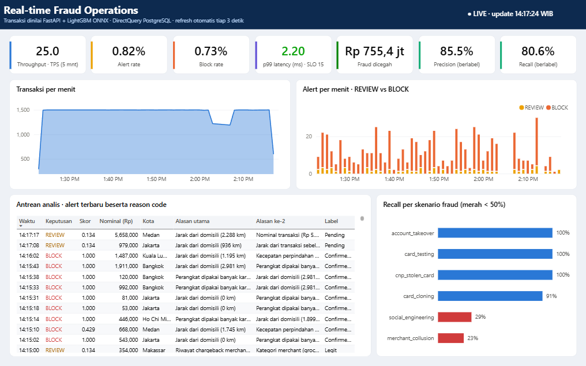
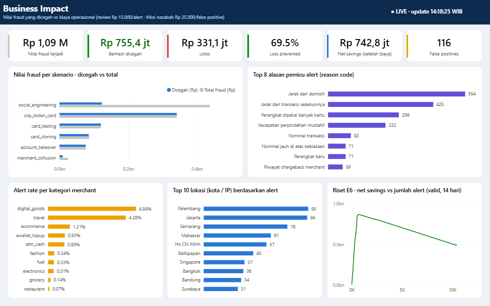
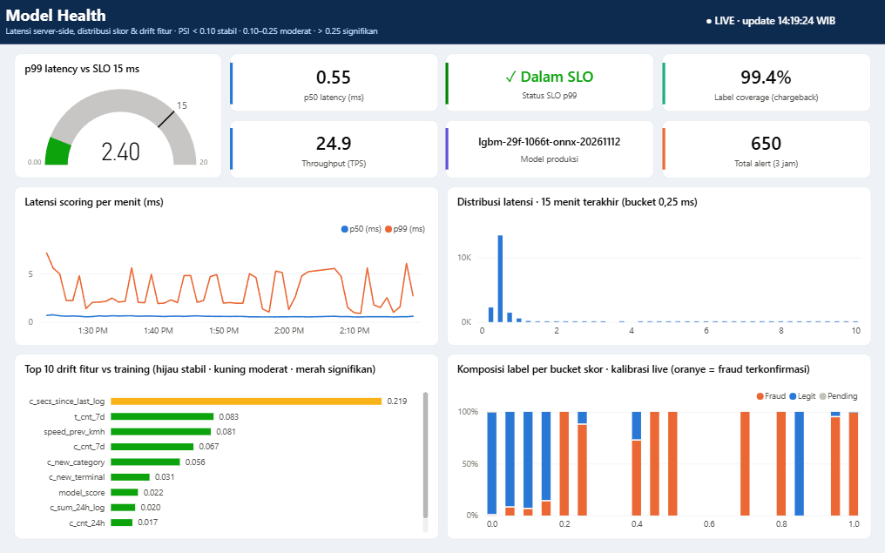
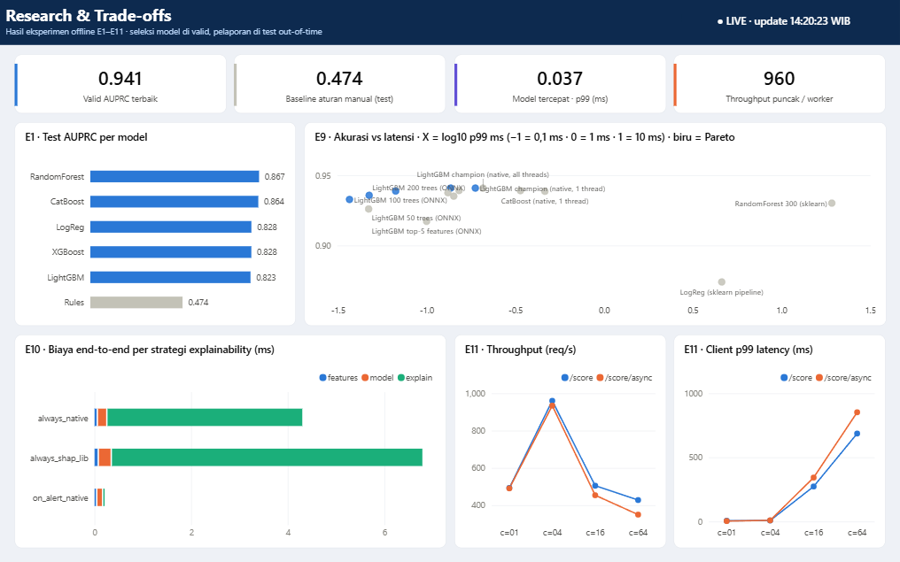
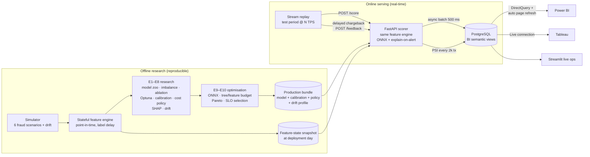

# 🛡️ Real-time Fraud Detection: dari riset sampai dashboard live

End-to-end fraud detection untuk transaksi kartu (Rupiah, 10 kota Indonesia). Proyek mencakup **riset model yang
reprodusibel** dan **optimasi latensi dengan uji trade-off**, lalu **serving realtime** yang memberi keputusan
APPROVE / REVIEW / BLOCK beserta *reason code*. Hasilnya dipantau di **dashboard Power BI / Tableau / Streamlit**
yang ter-update setiap 2 detik.

<!-- RESULTS:START -->


| Business Impact | Model Health | Research & Trade-offs |
|---|---|---|
|  |  |  |

*Dashboard Power BI (DirectQuery ke PostgreSQL, auto page refresh) di-generate dari kode → [`dashboard/powerbi`](dashboard/powerbi/README.md).
Alternatif tanpa Power BI: Streamlit live monitor (`streamlit run dashboard/streamlit/app.py`).*

### Hasil utama (test out-of-time 23 hari, 171.612 transaksi)

| | |
|---|---|
| **Model produksi** | LightGBM (29 fitur, 1.066 pohon, Optuna) → ONNX Runtime single-thread |
| **AUPRC** | **0.844** (aturan manual 0.474 → **1,8×**) · ROC-AUC 0.977 · Precision@50/hari 0.86 |
| **Keputusan REVIEW** | recall **79,8%** · precision **83,5%** · alert hanya 0,77% transaksi |
| **Nilai bisnis** | 68,5% nilai fraud tercegah · **net savings Rp 1,66 miliar** setelah biaya review & friksi |
| **Latensi** | model p99 **0,137 ms** · end-to-end (fitur + model + reason code) p99 **4,2 ms** (SLO 15 ms ✓) |
| **Throughput** | ±960 req/s per worker HTTP. Server-side p99 tetap 0,6–4,6 ms di semua level beban |
| **Parity** | fitur online vs offline: selisih maksimum **0** |

### Temuan riset yang paling menarik

1. **Runtime > arsitektur model.** Pada akurasi sebanding, RandomForest sklearn p99 19 ms vs LightGBM ONNX 0,137 ms (**141×**).
2. **Explainability adalah biaya latensi terbesar.** TreeSHAP per transaksi (6,5 ms) lebih mahal daripada inferensi
   (0,1 ms). Strategi *explain-on-alert* menurunkan p50 end-to-end dari 6,6 ms ke 0,14 ms.
3. **Concept drift tidak terlihat oleh PSI.** Pola scam baru (`social_engineering`) membuat recall mingguan turun
   0,79 → 0,59, tetapi PSI fitur tetap < 0,005. Monitoring wajib dua lapis: PSI **dan** performa berlabel.
4. **Kalibrasi isotonic bisa merusak ranking.** Fungsi tangga membuat skor kembar (AUPRC −0,02). Ini diperbaiki
   dengan *tie-break* yang menjaga monotonisitas ketat.
5. **Out-of-order events nyata terjadi.** Load test konkuren memicu crash pada feature engine versi awal. Engine sekarang
   menyisipkan event terlambat di posisi yang benar (ada unit test-nya).

📄 Laporan lengkap: [`reports/RESEARCH_REPORT.md`](reports/RESEARCH_REPORT.md) (E1–E11, auto-generated dari hasil run)
<!-- RESULTS:END -->

## Arsitektur



**Keputusan desain penting**

| Keputusan | Alasan |
|---|---|
| **Satu feature engine untuk offline & online** | Training-serving skew tidak mungkin terjadi. Parity diuji otomatis (`tests/test_serving.py`) |
| **Split berbasis waktu + gap label delay 7 hari** | Chargeback datang terlambat. Random split membocorkan masa depan dan memberi skor palsu |
| **AUPRC + Precision@K/hari + nilai Rupiah** | Akurasi tidak berarti pada fraud rate < 1%. Bisnis memikirkan kapasitas analis & kerugian |
| **Kalibrasi isotonic + threshold berbasis biaya** | Threshold 0.5 tidak bermakna. REVIEW = net savings maksimum, BLOCK = precision ≥ 90% |
| **Scoring sinkron (request/response), DB async** | Otorisasi kartu butuh jawaban dalam milidetik. Penulisan ke DB dikeluarkan dari jalur latensi |
| **ONNX Runtime single-thread + explain-on-alert** | Hasil E9/E10: runtime & strategi SHAP lebih menentukan latensi daripada pilihan model |
| **DirectQuery + auto page refresh** (bukan streaming dataset) | Streaming semantic model Power BI sedang dipensiunkan Microsoft. Pola ini juga portabel ke Tableau |

## Quickstart

```powershell
# 0) environment
python -m venv .venv; .venv\Scripts\Activate.ps1
pip install -r requirements.txt; pip install -e .

# 1) riset offline lengkap (~20–30 menit, CPU)
.\scripts\run_pipeline.ps1                # = data -> research -> optimize -> report

# 2) demo realtime: PostgreSQL + API + stream + Streamlit
.\scripts\run_live.ps1 -Tps 40
#    API docs   : http://127.0.0.1:8010/docs
#    Streamlit  : http://localhost:8501
#    Power BI   : buka dashboard/powerbi/FraudOps.pbip (login DB: fraud / fraud)

# 3) load test (API tanpa DB sink)
$env:FRAUDDET_SINK="off"; python -m frauddet.serving.api     # terminal 1
python -m frauddet.loadtest                                  # terminal 2

# 4) tests
pytest -q
```

Linux/macOS: `make all`, `make db`, `make api`, `make replay`, `make dashboard`.
Docker penuh: `docker compose --profile app up -d --build` (setelah langkah 1).

### Contoh request

```bash
curl -X POST http://127.0.0.1:8010/score -H "Content-Type: application/json" -d '{
  "tx_id": 1, "ts": "2026-08-06T02:14:00", "customer_id": 42, "terminal_id": 6650,
  "device_id": 10000007, "channel": "ONLINE", "category": "ewallet_topup",
  "amount": 9500000, "lat": 1.35, "lon": 103.82 }'
```

Respons nyata (panggilan pertama setelah API start, jadi masih *cold*):

```json
{ "fraud_score": 1.0, "raw_score": 0.998766, "decision": "BLOCK",
  "reasons": [ {"label": "Jarak dari domisili", "value": "628 km",       "contribution": 3.769},
               {"label": "Perangkat baru",      "value": "ya",           "contribution": 3.546},
               {"label": "Nominal transaksi",   "value": "Rp 9.500.000", "contribution": 1.914} ],
  "model_version": "lgbm-29f-1066t-onnx-20261112",
  "latency_ms": {"features": 0.20, "model": 0.80, "explain": 5.46, "total": 6.46} }
```
Transaksi normal (belanja grocery Rp 125.000 di Jakarta) → `APPROVE`, skor 0.0035, total 0.54 ms tanpa
reason code (*explain-on-alert*). Latensi *warm* ada di laporan E10.

## Struktur repository

```
├── configs/config.yaml          # satu-satunya sumber konfigurasi (split, biaya, SLO, port)
├── src/frauddet/
│   ├── simulator.py             # generator transaksi + 6 skenario fraud + drift
│   ├── features.py              # stateful point-in-time feature engine (offline = online)
│   ├── data.py                  # simulate -> replay -> parquet + state snapshot
│   ├── metrics.py · policy.py   # AUPRC, Precision@K, nilai bisnis; kalibrasi & 3-tier threshold
│   ├── research.py              # E1–E8
│   ├── optimize.py              # E9–E10 + production bundle
│   ├── loadtest.py              # E11
│   ├── monitoring.py            # PSI drift
│   ├── report.py                # auto-generate RESEARCH_REPORT.md
│   ├── db.py                    # PostgreSQL bootstrap + async batch sink
│   ├── serving/{scorer,api}.py  # jalur produksi + FastAPI
│   └── stream/replay.py         # stream test period + delayed labels
├── sql/{schema,views}.sql       # tabel operasional + semantic layer BI
├── dashboard/
│   ├── powerbi/                 # FraudOps.pbip (TMDL + PBIR) + build_pbip.py generator, theme, DAX
│   ├── tableau/                 # panduan & calculated fields
│   └── streamlit/app.py         # live ops dashboard (auto refresh 2 detik)
├── reports/                     # RESEARCH_REPORT.md, figures/, results/ (CSV/JSON)
├── tests/                       # unit + parity + API tests
└── docker-compose.yml · Dockerfile
```

## Lisensi

MIT. Data sepenuhnya sintetis, tidak ada data nasabah nyata.
