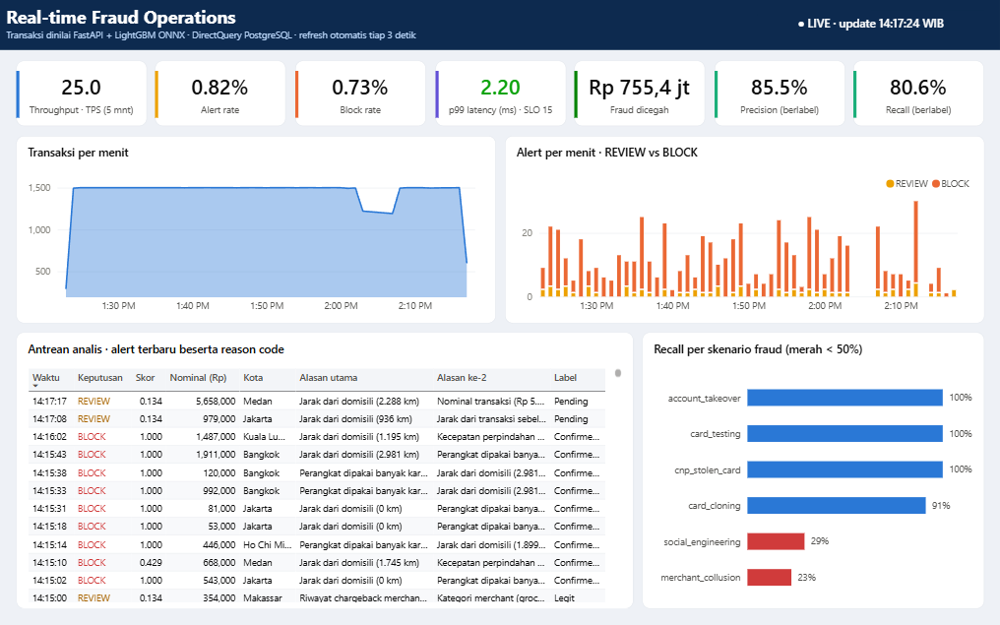
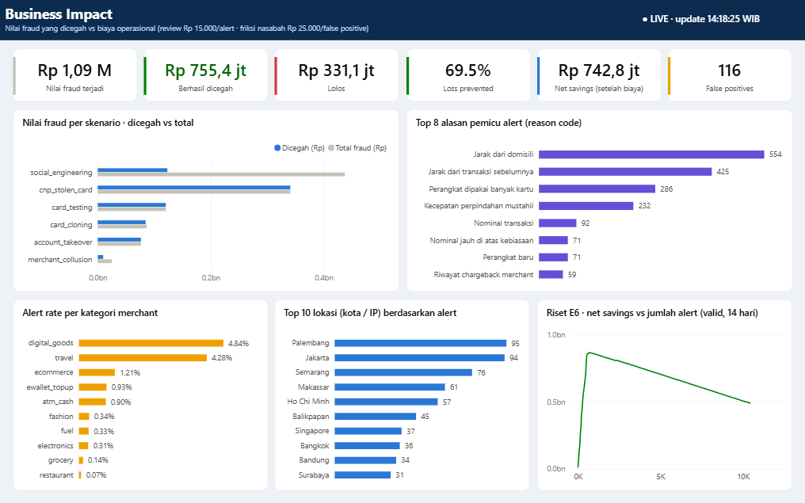
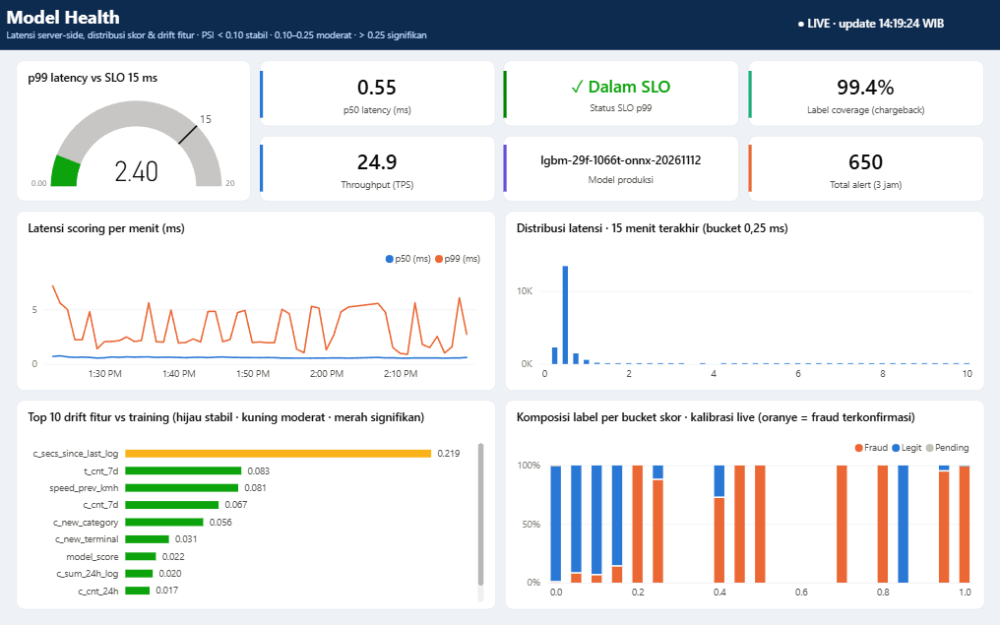
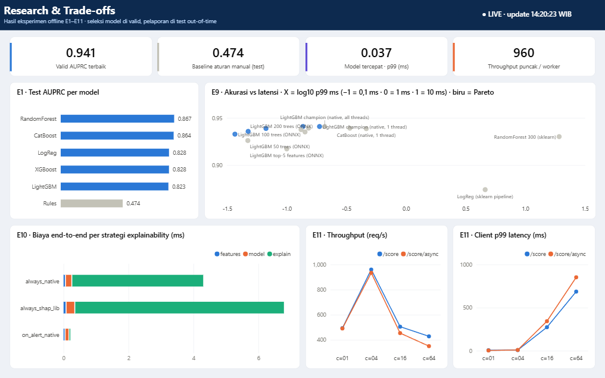

# Dashboard Power BI — Real-time Fraud Operations



| Business Impact | Model Health | Research & Trade-offs |
|---|---|---|
|  |  |  |

## Cara tercepat: buka file yang sudah jadi

Dashboard ini disimpan sebagai **Power BI Project (PBIP)**: semantic model dalam TMDL dan report dalam PBIR
(format teks berbasis JSON schema resmi Microsoft). Semuanya di-generate dari kode oleh [`build_pbip.py`](build_pbip.py),
jadi isinya bisa di-review dan di-diff di Git.

1. Jalankan database + stream (lihat README utama: `.\scripts
un_live.ps1`)
2. Buka **`dashboard/powerbi/FraudOps.pbip`** di Power BI Desktop (versi Sept 2026 ke atas)
3. Saat diminta kredensial PostgreSQL: user `fraud`, password `fraud` → **Connect**. Ini hanya sekali.

| Halaman | Isi | Refresh |
|---|---|---|
| **Real-time Fraud Operations** | 7 KPI (TPS, alert/block rate, p99 vs SLO, fraud dicegah, precision, recall), tren per menit, antrean analis + reason code, recall per skenario | 3 dtk |
| **Business Impact** | nilai fraud terjadi/dicegah/lolos (Rp), net savings, false positives, nilai per skenario, top reason code, alert rate per kategori, top lokasi, kurva biaya riset | 5 dtk |
| **Model Health** | gauge p99 vs SLO, p50, status SLO, label coverage, versi model, tren latensi, histogram latensi, top-10 PSI drift, komposisi label per bucket skor (kalibrasi live) | 5 dtk |
| **Research & Trade-offs** | E1 model zoo, E9 Pareto akurasi–latensi, E10 biaya explainability, E11 load test | statis |

**Desain.** Header navy, kartu putih di atas kanvas abu-abu kebiruan, dan palet kategorikal yang sudah divalidasi aman
untuk buta warna. Warna status (hijau/kuning/merah) hanya dipakai bila nilainya punya arti, dan selalu disertai label
atau judul yang menjelaskan aturannya: p99 vs SLO 15 ms, recall < 50%, PSI 0.10/0.25, BLOCK/REVIEW. Nominal tampil
dalam format Rupiah ("Rp 755,4 jt"). Kanvas 1280×800 (16:10).

**Mengubah dashboard.** Edit `build_pbip.py`, lalu jalankan `python dashboard/powerbi/build_pbip.py` (butuh container
PostgreSQL karena tipe kolom dibaca dari database). Setelah itu buka ulang file `.pbip`.

> **Catatan teknis yang ditemukan saat membangun (Power BI Desktop 2.159):**
> - Auto page refresh di PBIR memakai `refreshType: 0D` dan **durasi ISO-8601** `duration: 'PT3S'`. Angka biasa
>   (`3D`) diterima tanpa error tetapi diabaikan. Format ini didapat dengan mengaktifkan refresh sekali di Desktop lalu
>   membaca `page.json` yang disimpan. Verifikasi: Postgres menerima query DirectQuery dari *Mashup Engine* tiap ±3–4 detik.
> - Theme kustom (RegisteredResources) yang di-generate di luar Desktop dibuang diam-diam, walaupun lolos
>   `reportThemeSchema-2.159`. Karena itu semua styling ditulis eksplisit per visual. `fraud_ops_theme.json` tetap
>   disediakan untuk impor manual (*View → Themes → Browse*) bila ingin menambah visual baru dengan gaya yang sama.
> - `axisScale: log` tidak diterapkan pada visual yang di-generate, sehingga sumbu log di-precompute di view
>   (`v_e9_plot.log10_p99_ms`). `MAX()` pada kolom boolean gagal di DAX, jadi diganti `SELECTEDVALUE`.
> - Desktop me-render dengan WebView2. Jendela yang tertutup jendela lain tidak di-repaint, jadi angka baru terlihat
>   saat jendela Power BI aktif.

---

## Membangun manual (referensi)

Bagian di bawah menjelaskan cara membangun dashboard yang sama secara manual, misalnya untuk Power BI versi lama.

## 0. Prasyarat

| Item | Catatan |
|---|---|
| Power BI Desktop (Windows, gratis) | Microsoft Store atau unduhan resmi |
| PostgreSQL berjalan | `docker compose up -d db` → `localhost:5434`, user/pass `fraud`/`fraud`, db `frauddb` |
| Data mengalir | API + replay jalan (lihat README utama, bagian *Quickstart*) |
| Tabel riset (opsional) | `python -m frauddet.db load-research` → tabel `r_*` |

> Konektor PostgreSQL di Power BI Desktop versi modern sudah membawa driver Npgsql.
> Jika muncul error driver, instal Npgsql sesuai pesan error konektor.

## 1. Koneksi data (DirectQuery)

1. **Home → Get data → PostgreSQL database**
2. Server: `localhost:5434` · Database: `frauddb` · **Data Connectivity mode: DirectQuery**
3. Kredensial *Database*: `fraud` / `fraud`
4. Centang view berikut:

| View | Dipakai untuk |
|---|---|
| `v_live_transactions` | fact table utama (3 jam terakhir) + semua measure |
| `v_kpi_current` | kartu KPI: TPS, p50/p99 latensi 5 menit |
| `v_kpi_minute` | tren per menit |
| `v_alert_queue` | tabel antrean analis + reason code |
| `v_scenario_performance` | recall per skenario fraud |
| `v_city_risk` | peta |
| `v_reason_frequency` | alasan alert terbanyak |
| `v_latency_histogram`, `v_score_distribution` | halaman Model Health |
| `v_drift_latest`, `v_drift_history`, `v_model_registry` | drift & versi model |

5. (Opsional, halaman Research) **Get data → PostgreSQL** lagi, kali ini mode **Import**, pilih tabel
   `r_e1_model_comparison`, `r_e9_variants`, `r_e6_threshold_sweep_valid`, `r_e8_scenario_recall`,
   `r_e10_end_to_end`, `r_e11_loadtest`, `r_e7_shap_importance`. Power BI otomatis menjadikannya *composite model*.

Tidak perlu relasi antartabel. Setiap view sudah teragregasi untuk satu visual, jadi query DirectQuery tetap ringan.

## 2. Theme dan measure

1. **View → Themes → Browse for themes** → pilih `dashboard/powerbi/fraud_ops_theme.json`
   (palet kategorikal yang sudah divalidasi aman untuk buta warna, warna status hijau/kuning/merah khusus untuk status).
2. Pilih tabel `v_live_transactions` → **Modeling → New measure** → salin measure dari
   [`measures.dax`](measures.dax) satu per satu.
3. Format: `Alert Rate`, `Block Rate`, `Precision`, `Recall`, `Loss Prevented %` → *Percentage*, 1 desimal;
   measure Rupiah → *Whole number* dengan pemisah ribuan.

## 3. Layout halaman

Kanvas 16:9 (1280×720). Grid 12 kolom, margin 16 px.

### Halaman 1 — **Live Operations**

```
┌────────────────────────────────────────────────────────────────────────────┐
│ Real-time Fraud Operations            [Last Update]   [Model Version]      │
├──────────┬──────────┬──────────┬──────────┬──────────┬──────────┬──────────┤
│ TPS 5m   │Alert Rate│Block Rate│ P99 (ms) │Intercept │Precision │ Recall   │  ← Card (new)
├──────────┴──────────┴──────────┼──────────┴──────────┴──────────┴──────────┤
│ Line: n_tx per minute_wib      │ Stacked column: alerts per minute         │
│ (v_kpi_minute)                 │ (n_alert - n_block = REVIEW, n_block)     │
├────────────────────────────────┼───────────────────────────────────────────┤
│ Table: v_alert_queue           │ Bar: v_scenario_performance[recall]       │
│ time·decision·score·amount·    │ per scenario, sort ascending              │
│ city·reason_1·reason_2·label   ├───────────────────────────────────────────┤
│ (conditional format decision   │ Map/Bubble: v_city_risk (lat, lon,        │
│  pakai measure Decision Color) │ size = n_tx, color sat. = alert_rate)     │
└────────────────────────────────┴───────────────────────────────────────────┘
```

| Visual | Field |
|---|---|
| Cards | `TPS 5m`, `Alert Rate`, `Block Rate`, `P99 Latency 5m (ms)`, `Fraud Amount Intercepted (Rp)`, `Precision`, `Recall` |
| P99 card | Conditional formatting → *Callout value color* → Field value = `Latency Status Color`; tambah subtitle `Latency Status Label` (warna + ikon/teks, tidak mengandalkan warna saja) |
| Line chart | X = `v_kpi_minute[minute_wib]`, Y = `n_tx`; satu seri, tanpa legend |
| Stacked column | X = `minute_wib`, Y = `n_alert` dan `n_block` (atau buat kolom REVIEW = n_alert − n_block di Power Query) |
| Table | `v_alert_queue`: `scored_at_wib`, `decision`, `fraud_score` (data bar), `amount_idr`, `channel`, `city`, `reason_1`, `reason_2`, `label_status` |
| Bar | Y = `scenario`, X = `recall` (format %), data label on |
| Map | Visual *Azure Maps* (atau *Scatter* lat/lon bila map dinonaktifkan admin): Latitude = `lat`, Longitude = `lon`, Size = `n_tx`, Tooltip = `n_alert`, `n_fraud`, `alert_rate` |

### Halaman 2 — **Model Health**

| Visual | Field |
|---|---|
| Line (2 seri, satu sumbu ms) | `v_kpi_minute`: X = `minute_wib`, Y = `p50_latency_ms`, `p99_latency_ms`; Analytics pane → Constant line 15 (SLO) |
| Column | `v_latency_histogram`: X = `bucket_start_ms`, Y = `n` |
| Bar | `v_drift_latest`: Y = `feature`, X = `psi`; Conditional format bar color = `Drift Color`; data label = `level` |
| Clustered column | `v_score_distribution`: X = `score_from`, Y = `n`, Legend = `label` (Y log scale) |
| Table | `v_model_registry` |

Aturan baca PSI: < 0.10 stabil · 0.10–0.25 moderat (investigasi) · > 0.25 signifikan (retrain).

### Halaman 3 — **Research & Trade-off** (Import)

| Visual | Field |
|---|---|
| Bar | `r_e1_model_comparison`: model vs `test_auprc` (sort desc) |
| Scatter | `r_e9_variants`: X = `p99_ms` (log), Y = `valid_auprc`, Legend = `pareto`, Tooltip = `variant`, `size_kb` |
| Line | `r_e6_threshold_sweep_valid`: X = `threshold` (log), Y = `net_savings` |
| Stacked bar | `r_e10_end_to_end`: Y = `mode`, X = `features_mean_ms`, `model_mean_ms`, `explain_mean_ms` |
| Line ×2 | `r_e11_loadtest`: concurrency vs `throughput_rps` dan concurrency vs `p99_ms` (**dua visual terpisah**, jangan dual-axis) |

## 4. Mengaktifkan realtime: Automatic page refresh

1. Klik kanvas kosong pada halaman *Live Operations* → panel **Format page** → **Page refresh = On**
2. Refresh type: **Auto page refresh** → interval **2–5 seconds**
3. Ulangi untuk halaman *Model Health* (5–10 detik sudah cukup)

Di **Power BI Desktop** interval detik berjalan langsung. Setelah **publish ke Power BI Service**, interval minimum
mengikuti kapasitas workspace dan pengaturan admin: refresh tingkat detik memerlukan kapasitas Premium/Fabric,
sedangkan shared capacity dibatasi jauh lebih lambat. Untuk Service juga diperlukan *on-premises data gateway* karena
database berada di laptop/VM.

> **Catatan tentang "Streaming dataset" Power BI.** Fitur *real-time streaming / push semantic model*
> sedang dipensiunkan oleh Microsoft. Pembuatan model baru masih bisa sampai **31 Oktober 2027**, dan Microsoft
> mengarahkan migrasi ke **Fabric Real-Time Intelligence** (Eventstream + Eventhouse). Karena itu project ini memakai
> pola **DirectQuery + Automatic page refresh** yang tetap didukung dan portabel ke Tableau.

## 5. Checklist kualitas

- [ ] Semua kartu menampilkan angka (bukan *blank*) saat replay berjalan
- [ ] Precision/Recall mulai terisi ±20 detik setelah replay dimulai (label delay)
- [ ] p99 latensi < 15 ms (SLO) — warna hijau + label "✓ SLO terpenuhi"
- [ ] Recall skenario `social_engineering` terlihat paling rendah: ini bukti *concept drift* (pola tidak ada di data training)
- [ ] Simpan sebagai `dashboard/powerbi/FraudOps.pbix` atau format **Power BI Project (.pbip)** agar bisa di-diff di Git
