# Research Report — Real-time Fraud Detection

> Laporan ini **di-generate otomatis** oleh `python -m frauddet.report` dari `reports/results/*`.
> Semua angka berasal dari run terakhir pipeline (seed 42).

## 1. Ringkasan eksekutif

| Item | Hasil |
|---|---|
| Data | 738,652 transaksi berlabel (train/valid/test), fraud rate ≈ 0.81% di test |
| Model produksi | **lgbm-29f-1066t-onnx-20261112** (LightGBM champion (ONNX Runtime)) |
| Kualitas (test out-of-time) | AUPRC **0.844** · ROC-AUC 0.977 · Precision@50/hari 0.86 |
| Baseline aturan manual | AUPRC 0.474 → model **1.8× lebih baik** |
| Keputusan REVIEW (test) | recall 79.8% · precision 83.5% · 1,324 alert |
| Nilai fraud tercegah (test, 23 hari) | 68.5% dari nilai fraud · net savings **Rp 1.66 miliar** setelah biaya review & friksi |
| Latensi model (single row) | p50 0.091 ms · p99 **0.137 ms** (SLO 2.0 ms) |
| Latensi end-to-end in-process | p50 0.143 ms · p99 **4.208 ms** (SLO 15.0 ms → ✓ terpenuhi) |
| Training/serving parity | max \|online − offline\| = 0.0e+00 (fitur identik) |

## 2. Desain eksperimen

* **Data**: simulator transaksi kartu Indonesia (10 kota, Rupiah) dengan 6 skenario fraud. Satu skenario
  (`social_engineering`) **hanya muncul di periode test**, untuk menguji ketahanan terhadap *concept drift*.
* **Split berbasis waktu dengan label delay**: train hari 14–75 → valid 76–89 → *gap* 90–96 → test 97–119.
  Gap 7 hari ada karena chargeback baru matang setelah ±7 hari, jadi saat model di-deploy pada hari 97,
  label hari 90–96 belum tersedia. Tidak ada random split, karena random split membocorkan masa depan.
* **Fitur point-in-time**: 29 fitur dari *stateful feature engine* yang sama untuk offline & online
  (velocity 1 jam/24 jam/7 hari/30 hari, profil nominal, geo & *impossible travel*, risiko merchant dengan label
  tertunda, graph perangkat). Biaya ±18 µs/transaksi.
* **Metrik utama AUPRC** (bukan akurasi/ROC-AUC) karena kelas sangat tidak seimbang. Pendukung: Precision@50/hari
  (kapasitas analis), recall@0.5% FPR, Brier/ECE (kalibrasi), dan **nilai bisnis Rupiah**.
* **Seleksi model hanya memakai valid**. Test disentuh sekali untuk pelaporan.

## 3. E1 — Perbandingan keluarga model

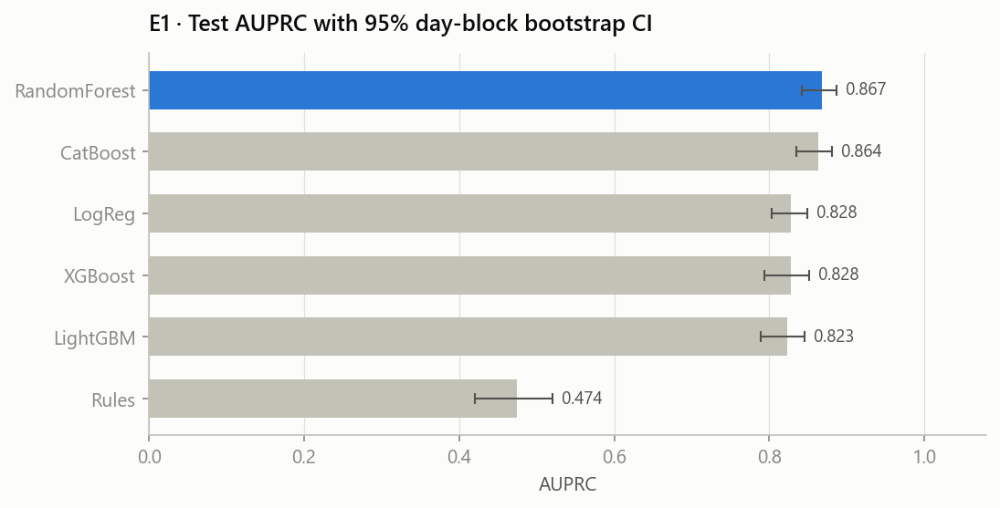

| model | valid_auprc | test_auprc | test_auprc_ci_low | test_auprc_ci_high | test_roc_auc | test_precision@50/day | train_time_s |
|---|---|---|---|---|---|---|---|
| RandomForest | 0.9302 | 0.8675 | 0.8420 | 0.8863 | 0.9876 | 0.8600 | 94.7000 |
| CatBoost | 0.9386 | 0.8635 | 0.8346 | 0.8808 | 0.9866 | 0.8539 | 57.7000 |
| LogReg | 0.8741 | 0.8280 | 0.8027 | 0.8487 | 0.9805 | 0.8096 | 1.6000 |
| XGBoost | 0.9394 | 0.8278 | 0.7934 | 0.8513 | 0.9782 | 0.8357 | 14.8000 |
| LightGBM | 0.9391 | 0.8235 | 0.7884 | 0.8458 | 0.9675 | 0.8383 | 18 |
| Rules | 0.4959 | 0.4741 | 0.4202 | 0.5208 | 0.9350 | 0.5487 | 0.0000 |

**Temuan.** Semua model ML jauh di atas aturan manual (AUPRC 0.474). Di validasi, boosting
(XGBoost, 0.939) memimpin. Di test, CI 95% (bootstrap per hari) antar-GBDT saling tumpang
tindih, jadi selisih kecil di test **tidak signifikan**. Penurunan valid → test yang seragam di semua model
disebabkan oleh skenario baru (lihat E8), bukan overfitting satu model.

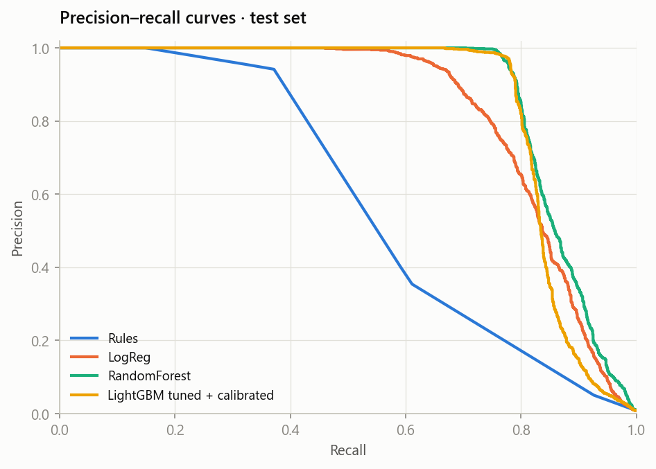

## 4. E2 — Penanganan class imbalance

| strategy | train_rows | valid_auprc | test_auprc | test_roc_auc | test_brier_raw | mean_pred_vs_base_rate | train_time_s |
|---|---|---|---|---|---|---|---|
| none | 462,680 | 0.9391 | 0.8235 | 0.9675 | 0.0024 | 0.7142 | 15.4000 |
| scale_pos_weight=sqrt | 462,680 | 0.9398 | 0.8262 | 0.9682 | 0.0024 | 0.7256 | 19.7000 |
| is_unbalance (=neg/pos) | 462,680 | 0.9371 | 0.8263 | 0.9688 | 0.0022 | 0.7668 | 16.4000 |
| undersample 1:20 | 59,373 | 0.9371 | 0.8233 | 0.9747 | 0.0025 | 0.8504 | 4.6000 |
| SMOTE (5%) | 482,849 | 0.9395 | 0.8414 | 0.9824 | 0.0023 | 0.7707 | 7.6000 |

**Temuan.** Reweighting dan resampling hanya menggeser AUPRC dalam rentang yang sama, tetapi mengubah skala
probabilitas (`mean_pred_vs_base_rate` ≠ 1). Karena keputusan berbasis biaya butuh probabilitas yang jujur,
pipeline memilih **tanpa resampling + kalibrasi isotonic** (E5), dan memberi Optuna kebebasan menyetel
`scale_pos_weight` sebagai hyperparameter.

## 5. E3 — Ablasi keluarga fitur

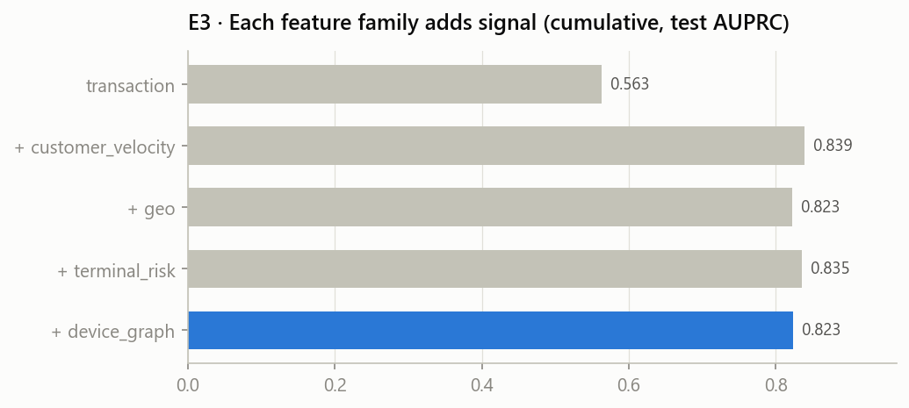

| setting | mode | n_features | valid_auprc | test_auprc |
|---|---|---|---|---|
| transaction | cumulative | 7 | 0.4587 | 0.5628 |
| + customer_velocity | cumulative | 19 | 0.8155 | 0.8387 |
| + geo | cumulative | 22 | 0.9234 | 0.8227 |
| + terminal_risk | cumulative | 26 | 0.9368 | 0.8353 |
| + device_graph | cumulative | 29 | 0.9391 | 0.8235 |
| - customer_velocity | leave_one_out | 17 | 0.9343 | 0.8139 |
| - geo | leave_one_out | 26 | 0.8796 | 0.8602 |
| - terminal_risk | leave_one_out | 25 | 0.9254 | 0.8258 |
| - device_graph | leave_one_out | 26 | 0.9368 | 0.8353 |

**Temuan.** Fitur transaksi mentah saja hanya mencapai AUPRC 0.563. Fitur *behavioural*
(velocity, profil nominal) memberi lompatan terbesar menjadi 0.839. Leave-one-out paling
merugikan bila **- customer_velocity** dihapus
(Δ test -0.010). Catatan jujur: menghapus satu keluarga fitur bisa
*menaikkan* AUPRC test (Δ terbesar +0.037 untuk - geo)
karena model yang sangat bergantung pada sinyal tersebut lebih mudah tertipu pola baru
(`social_engineering` dilakukan dari lokasi dan perangkat korban sendiri). Ini argumen untuk *monitoring drift* dan
retraining berkala, bukan untuk membuang fitur berdasarkan data test.

## 6. E4 — Hyperparameter optimisation (Optuna TPE)

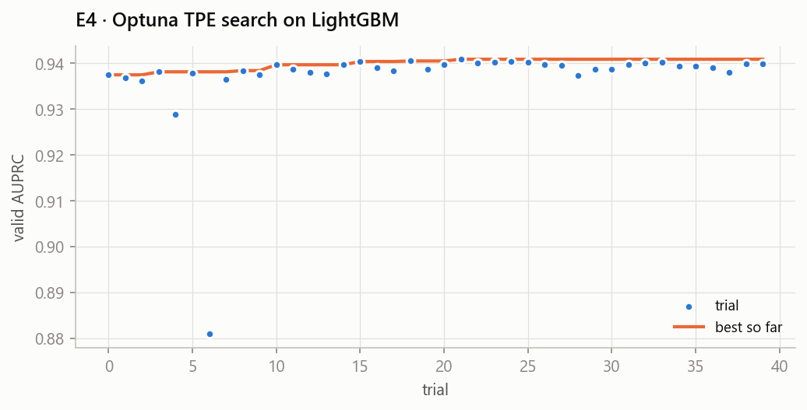

* 40 trial · trial 0 = parameter default E1 (valid AUPRC 0.9375)
* Terbaik: valid AUPRC **0.9409** (+0.0034), best iteration 1066
* Parameter: `{"learning_rate": 0.0155, "num_leaves": 23, "min_child_samples": 243, "feature_fraction": 0.5543, "bagging_fraction": 0.9415, "lambda_l1": 2.5262, "lambda_l2": 0.0303, "max_bin": 255, "scale_pos_weight": 3.3923}`

## 7. E5 — Kalibrasi probabilitas

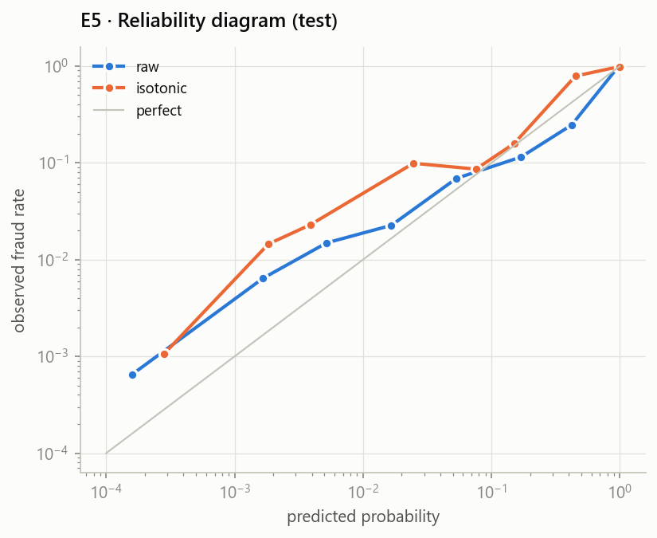

| method | test_brier | test_ece | test_auprc |
|---|---|---|---|
| raw | 0.00192 | 0.00120 | 0.84407 |
| platt | 0.00195 | 0.00149 | 0.84407 |
| isotonic | 0.00196 | 0.00138 | 0.84407 |

Pada run ini skor mentah sudah terkalibrasi baik (ECE test 0.00120 vs isotonic 0.00138; selisihnya tipis). Isotonic tetap dipakai sebagai **pengaman**: Optuna bebas memilih `scale_pos_weight` (di sini 3.39) yang menggeser skala probabilitas, sehingga tanpa kalibrasi threshold biaya bisa meleset setiap kali model di-retrain.
Kalibrasi memakai *tie-break* 1e-6 dengan skor mentah, sehingga pemetaan monoton ketat dan AUPRC identik dengan model
mentah. Tanpa tie-break, fungsi tangga isotonic membuat skor kembar dan pada percobaan awal AUPRC turun ±0.02.
Kalibrasi disimpan sebagai dua array dan dievaluasi dengan satu `np.interp` di jalur serving (< 1 µs).

## 8. E6 — Kebijakan keputusan berbasis biaya

Biaya: review analis Rp 15,000 per alert, friksi nasabah Rp 25,000 per false positive.

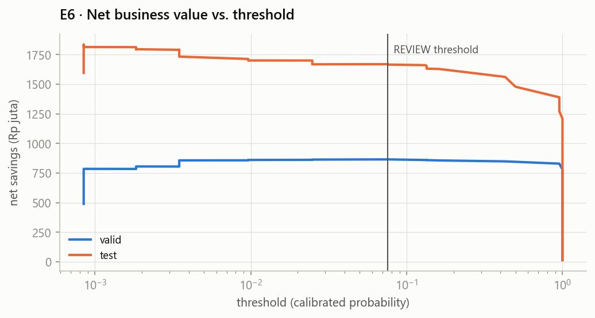

| Tier | Threshold (dipilih di valid) | Precision test | Recall test | Alert test | Fraud tercegah |
|---|---|---|---|---|---|
| REVIEW (≥) | 0.0758 | 83.5% | 79.8% | 1,324 | 68.5% |
| BLOCK (≥) | 0.1343 | 93.3% | 78.4% | 1,164 | 66.9% |

REVIEW = threshold yang memaksimalkan *net savings* di valid. BLOCK = threshold terendah dengan precision valid
≥ 90%, sehingga hanya transaksi yang hampir pasti fraud yang ditolak otomatis.

## 9. E7 — Explainability (TreeSHAP)

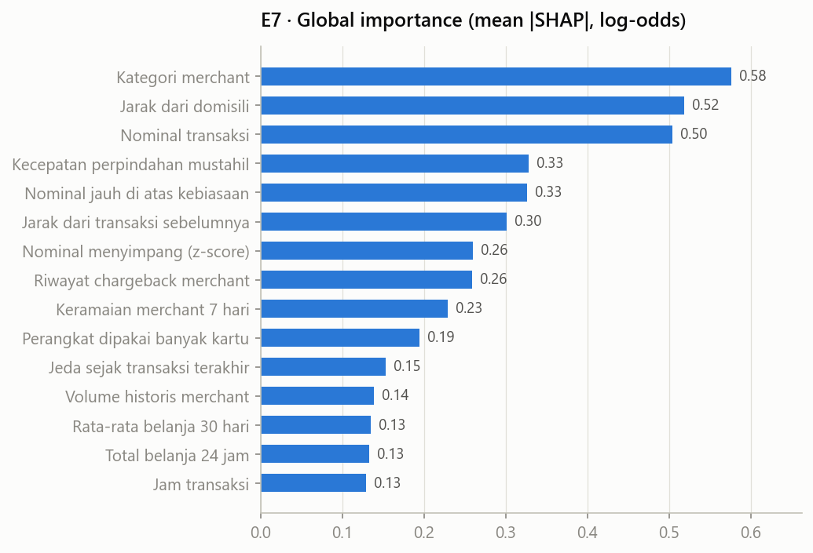

Fitur yang paling menentukan per skenario (rata-rata SHAP pada transaksi fraud di test):

| scenario | n | top1 | top2 | top3 |
|---|---|---|---|---|
| account_takeover | 70 | Jarak dari domisili | Perangkat dipakai banyak kartu | Jarak dari transaksi sebelumnya |
| card_cloning | 71 | Jarak dari domisili | Nominal transaksi | Nominal jauh di atas kebiasaan |
| card_testing | 403 | Jarak dari domisili | Jarak dari transaksi sebelumnya | Perangkat dipakai banyak kartu |
| cnp_stolen_card | 452 | Jarak dari domisili | Perangkat dipakai banyak kartu | Jarak dari transaksi sebelumnya |
| merchant_collusion | 73 | Riwayat chargeback merchant | Nominal jauh di atas kebiasaan | Nominal transaksi |
| social_engineering | 317 | Nominal jauh di atas kebiasaan | Nominal transaksi | Kecepatan perpindahan mustahil |

Setiap alert di API membawa 3 *reason code* (kontribusi SHAP positif terbesar) dalam Bahasa Indonesia, misalnya
"Perangkat baru (ya)" atau "Kecepatan perpindahan mustahil (1.840 km/jam)". Ini syarat auditabilitas untuk tim
analis dan regulator.

## 10. E8 — Robustness & concept drift

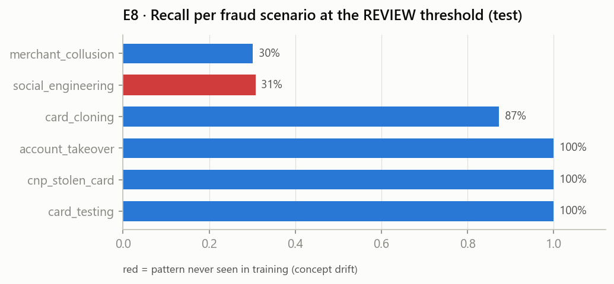

| scenario | n | caught | amount | recall |
|---|---|---|---|---|
| merchant_collusion | 73 | 22 | 80,812,000 | 0.3014 |
| social_engineering | 317 | 97 | 1,061,156,000 | 0.3060 |
| card_cloning | 71 | 62 | 128,522,000 | 0.8732 |
| account_takeover | 70 | 70 | 264,100,000 | 1 |
| cnp_stolen_card | 452 | 452 | 698,081,000 | 1 |
| card_testing | 403 | 403 | 233,939,000 | 1 |

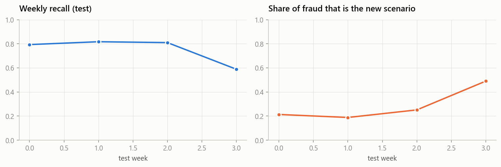

**Temuan.**
* Dua skenario terlemah: **merchant_collusion** (recall 30%) dan
  **social_engineering** (recall 31%). `merchant_collusion` hanya terlihat dari
  riwayat chargeback merchant, dan sinyal itu baru muncul setelah label delay 7 hari. `social_engineering` tidak
  pernah ada di training (nasabah sendiri yang bertransaksi dari perangkat & lokasinya), sehingga model hanya
  menangkapnya lewat nominal yang tidak biasa.
* **PSI tidak mendeteksi drift ini.** PSI fitur per minggu di test maksimal 0.004 (jauh di bawah 0.10), karena
  skenario baru hanya ±0,2% transaksi dan distribusi fitur nyaris tidak bergeser. Yang berubah adalah *hubungan*
  fitur→label (**concept drift**), dan itu hanya terlihat dari **recall berlabel** yang turun dari
  0.79 ke 0.59 ketika porsi `social_engineering` naik ke
  49%. Pelajarannya: monitoring produksi butuh dua lapis, yaitu PSI (covariate
  drift, tanpa label) **dan** performa berlabel per segmen dengan label delay. Keduanya ada di dashboard.

| week | start_day | n_tx | fraud_rate | auprc | recall_at_review | share_social_engineering | psi_amount_log | psi_c_amt_ratio_30d | psi_dist_home_km | psi_d_new_for_customer | psi_category_code |
|---|---|---|---|---|---|---|---|---|---|---|---|
| 0 | 97 | 52,530 | 0.009 | 0.834 | 0.793 | 0.213 | 0.000 | 0.000 | 0.000 | 0.001 | 0.000 |
| 1 | 104 | 52,533 | 0.008 | 0.858 | 0.817 | 0.188 | 0.000 | 0.000 | 0.000 | 0.001 | 0.000 |
| 2 | 111 | 52,463 | 0.009 | 0.861 | 0.810 | 0.251 | 0.000 | 0.000 | 0.000 | 0.001 | 0.000 |
| 3 | 118 | 14,086 | 0.004 | 0.654 | 0.588 | 0.490 | 0.000 | 0.000 | 0.001 | 0.004 | 0.001 |

## 11. E9 — Optimasi & trade-off akurasi vs latensi

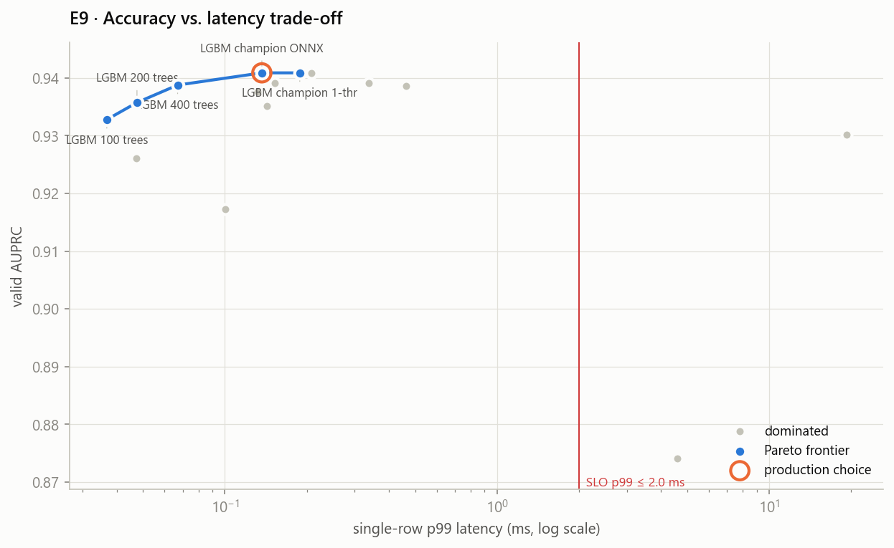

| variant | n_features | n_trees | size_kb | valid_auprc | test_auprc | p50_ms | p99_ms | explain_p99_ms | batch_rows_per_s | pareto |
|---|---|---|---|---|---|---|---|---|---|---|
| LogReg (sklearn pipeline) | 29 | – | 6 | 0.8741 | 0.8280 | 2.7344 | 4.6147 | – | 1,147,160 | False |
| RandomForest 300 (sklearn) | 29 | 300 | 3,373 | 0.9302 | 0.8675 | 9.6680 | 19.2497 | – | 73,047 | False |
| XGBoost (native, 1 thread) | 29 | 466 | 1,948 | 0.9391 | 0.8296 | 0.1933 | 0.3384 | – | 112,410 | False |
| CatBoost (native, 1 thread) | 29 | 491 | 599 | 0.9386 | 0.8635 | 0.2419 | 0.4648 | – | 1,760,176 | False |
| LightGBM champion (native, all threads) | 29 | 1,066 | 2,667 | 0.9409 | 0.8441 | 0.1474 | 0.2084 | 5.9299 | 134,633 | False |
| LightGBM champion (native, 1 thread) | 29 | 1,066 | 2,667 | 0.9409 | 0.8441 | 0.1094 | 0.1884 | 6.1467 | 133,038 | True |
| LightGBM champion (ONNX Runtime) | 29 | 1,066 | 1,775 | 0.9409 | 0.8441 | 0.0907 | 0.1367 | 5.2155 | 153,559 | True |
| LightGBM 50 trees (ONNX) | 29 | 50 | 81 | 0.9260 | 0.8348 | 0.0247 | 0.0472 | 0.3317 | 1,954,932 | False |
| LightGBM 100 trees (ONNX) | 29 | 100 | 161 | 0.9328 | 0.8484 | 0.0194 | 0.0368 | 0.5445 | 1,499,940 | True |
| LightGBM 200 trees (ONNX) | 29 | 200 | 326 | 0.9357 | 0.8471 | 0.0254 | 0.0475 | 0.8128 | 770,801 | True |
| LightGBM 400 trees (ONNX) | 29 | 400 | 661 | 0.9388 | 0.8460 | 0.0406 | 0.0670 | 2.3717 | 480,871 | True |
| LightGBM top-5 features (ONNX) | 5 | 794 | 1,320 | 0.9172 | 0.8507 | 0.0683 | 0.1001 | 2.5044 | 254,419 | False |
| LightGBM top-10 features (ONNX) | 10 | 1,018 | 1,695 | 0.9351 | 0.8201 | 0.0864 | 0.1424 | 4.4365 | 199,034 | False |
| LightGBM top-15 features (ONNX) | 15 | 787 | 1,308 | 0.9376 | 0.8419 | 0.0938 | 0.1320 | 3.5667 | 210,586 | False |
| LightGBM top-20 features (ONNX) | 20 | 1,218 | 2,029 | 0.9392 | 0.8525 | 0.1002 | 0.1525 | 5.6982 | 130,294 | False |

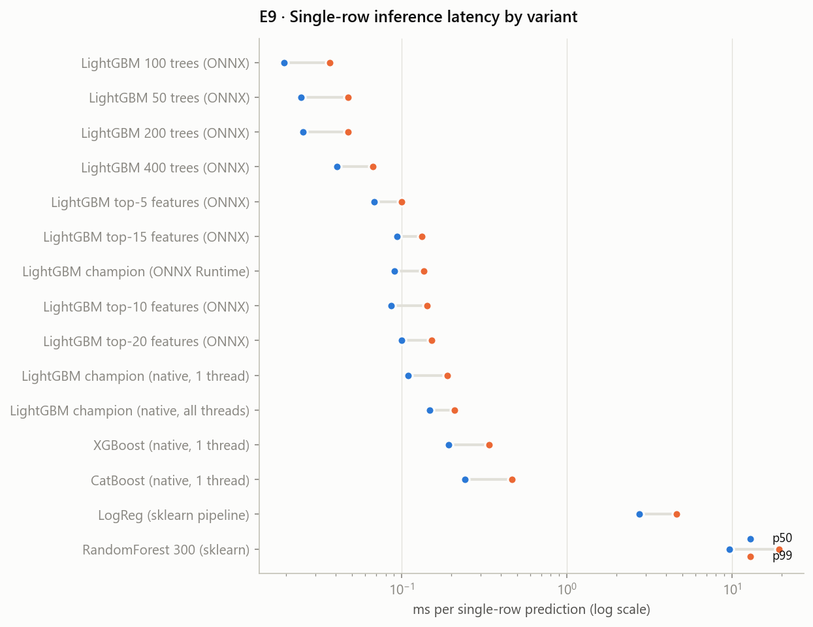
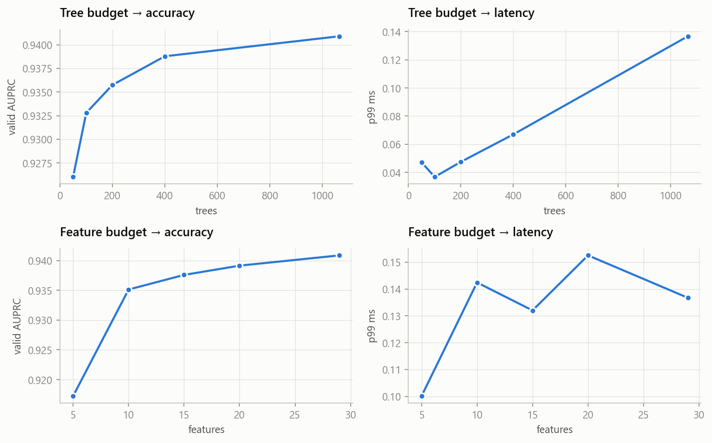

**Temuan.**
* **Runtime & keluarga model menentukan latensi.** Untuk akurasi yang setara, RandomForest sklearn butuh p99
  19.2 ms, sedangkan LightGBM ONNX hanya 0.137 ms (**141× lebih cepat**). Pipeline sklearn
  (LogReg) lambat untuk satu baris (4.6 ms) karena overhead per panggilan, meskipun throughput batch-nya tinggi.
* LightGBM yang sama: thread default p99 0.208 ms → 1 thread 0.188 ms → ONNX Runtime 0.137 ms.
  Skor ONNX hampir identik (max |Δp| = 6.2e-04, AUPRC sama) karena threshold disimpan float32.
* **Biaya explainability tumbuh dengan jumlah pohon.** p99 reason code (TreeSHAP) 0.33 ms untuk 50 pohon vs
  5.22 ms untuk champion (1066 pohon), dan ini *lebih mahal* daripada inferensi itu sendiri. Varian 400 pohon
  memangkas biaya explain ±2.2× dengan kehilangan AUPRC valid hanya 0.0021. Itu kandidat bila SLO
  end-to-end diperketat.
* **Tree/feature budget** memangkas latensi & ukuran model dengan penurunan AUPRC yang kecil, sehingga varian kecil
  berada di Pareto frontier (LightGBM 100 trees (ONNX), LightGBM 200 trees (ONNX), LightGBM 400 trees (ONNX), LightGBM champion (ONNX Runtime), LightGBM champion (native, 1 thread)).
* **Aturan seleksi**: AUPRC valid tertinggi dengan p99 ≤ 2.0 ms. Bila selisih ≤ 0.002,
  pilih yang lebih cepat → **LightGBM champion (ONNX Runtime)**.

## 12. E10 — Latensi end-to-end & strategi explainability

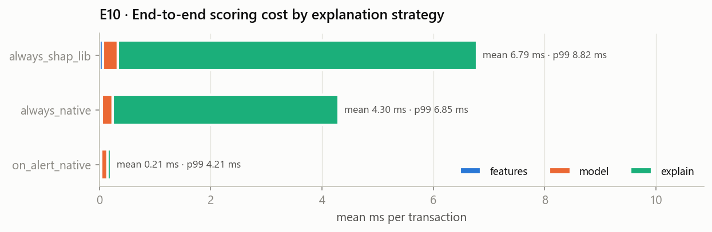

| mode | features_mean_ms | model_mean_ms | explain_mean_ms | total_mean_ms | total_p50_ms | total_p95_ms | total_p99_ms | alert_rate |
|---|---|---|---|---|---|---|---|---|
| always_shap_lib | 0.0629 | 0.2686 | 6.4536 | 6.7852 | 6.5922 | 7.7691 | 8.8238 | – |
| always_native | 0.0433 | 0.1967 | 4.0600 | 4.2999 | 4.0420 | 6.2424 | 6.8527 | – |
| on_alert_native | 0.0313 | 0.1215 | 0.0558 | 0.2086 | 0.1426 | 0.2224 | 4.2082 | 0.0130 |

Menghitung SHAP dengan library `shap` untuk setiap transaksi menambah ±6.45 ms.
TreeSHAP native LightGBM (`pred_contrib`) 4.06 ms. Strategi produksi
**explain-on-alert** hanya menghitung reason code untuk ±1.3%
transaksi yang di-alert, sehingga biaya rata-ratanya mendekati nol dan p99 menjadi 4.208 ms.

## 13. E11 — Load test API (HTTP, satu worker Uvicorn)

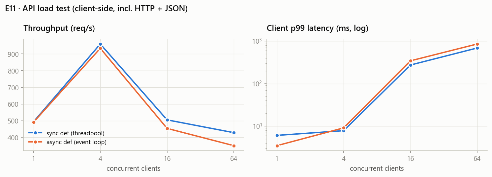

| endpoint | concurrency | requests | throughput_rps | p50_ms | p95_ms | p99_ms | server_p99_ms |
|---|---|---|---|---|---|---|---|
| /score | 1 | 3,000 | 493.21 | 1.86 | 2.76 | 6.05 | 4.46 |
| /score | 4 | 3,000 | 959.81 | 3.92 | 5.85 | 7.82 | 1.17 |
| /score | 16 | 3,000 | 504.95 | 12.85 | 131.10 | 273.23 | 1.93 |
| /score | 64 | 3,000 | 428.18 | 102.43 | 450.10 | 686.14 | 0.94 |
| /score/async | 1 | 3,000 | 490.95 | 1.99 | 2.67 | 3.47 | 0.62 |
| /score/async | 4 | 3,000 | 933.96 | 3.88 | 7.23 | 9.09 | 0.96 |
| /score/async | 16 | 3,000 | 453.99 | 14.80 | 136.06 | 342.79 | 4.63 |
| /score/async | 64 | 3,000 | 350.21 | 120.14 | 558.75 | 852.15 | 2.31 |

**Temuan.**
* Satu worker mencapai puncak **±960 req/s** pada 4 klien konkuren
  (client p99 7.8 ms).
* Di atas titik itu throughput **turun** dan client p99 meledak (hingga 852 ms), sementara
  **server-side p99 tetap 0.6–4.6 ms**. Artinya bottleneck ada di
  antrean HTTP/event loop satu proses Python (dan load generator di mesin yang sama), bukan di model atau
  feature engine.
* `async def` vs `def` (threadpool) praktis sama (puncak 934 vs 960 req/s):
  pekerjaan CPU-bound ±0.15 ms tidak diuntungkan oleh async. Default dipertahankan `def`.
* Implikasi kapasitas: untuk >1.000 TPS, tambah worker/pod dengan **partisi berdasarkan `customer_id`** (state velocity
  per nasabah tetap lokal) atau pindahkan state ke online store (Redis), plus admission control agar antrean tidak
  menembus SLO.

## Keterbatasan & langkah lanjut

* Data sintetis: pola fraud dirancang secara eksplisit, sehingga angka absolut tidak bisa langsung dibandingkan dengan
  data bank nyata. Metodologinya (split waktu + label delay, cost-based threshold, parity, SLO) tetap berlaku.
* Retraining terjadwal + *champion/challenger shadow scoring* dengan label baru (termasuk `social_engineering`).
* Graph features lanjutan (GNN pada graf kartu–perangkat–merchant) untuk mendeteksi sindikat.
* Online store terdistribusi (Redis) + Kafka/Redpanda untuk event log downstream, dengan beberapa worker scoring.
